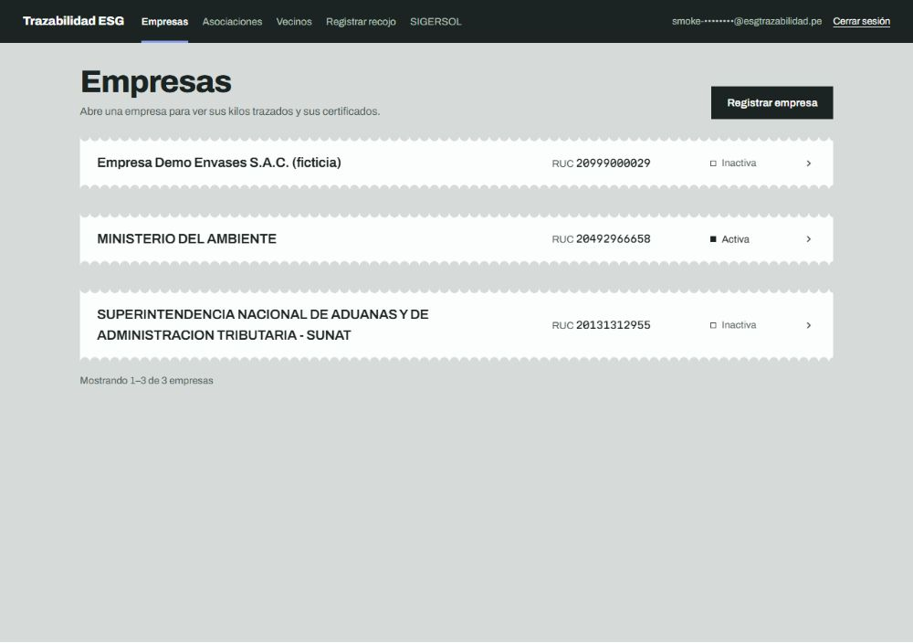
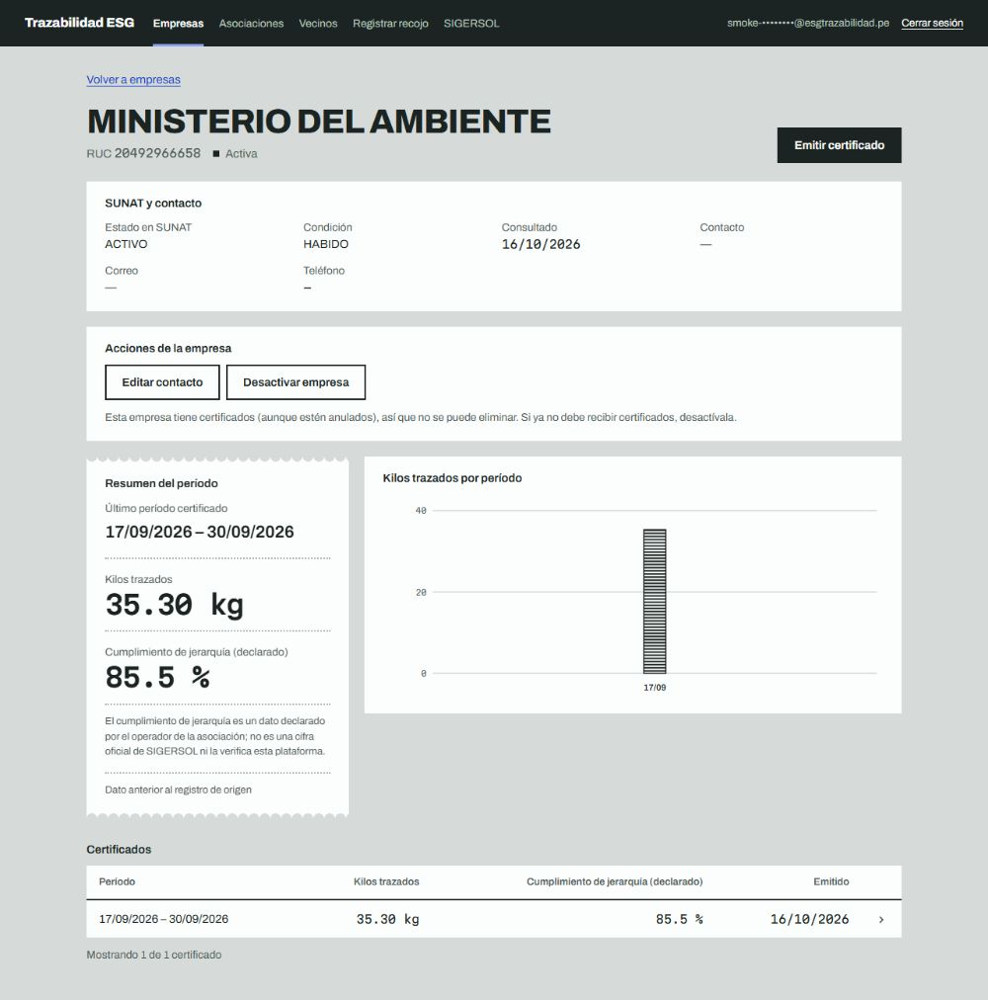
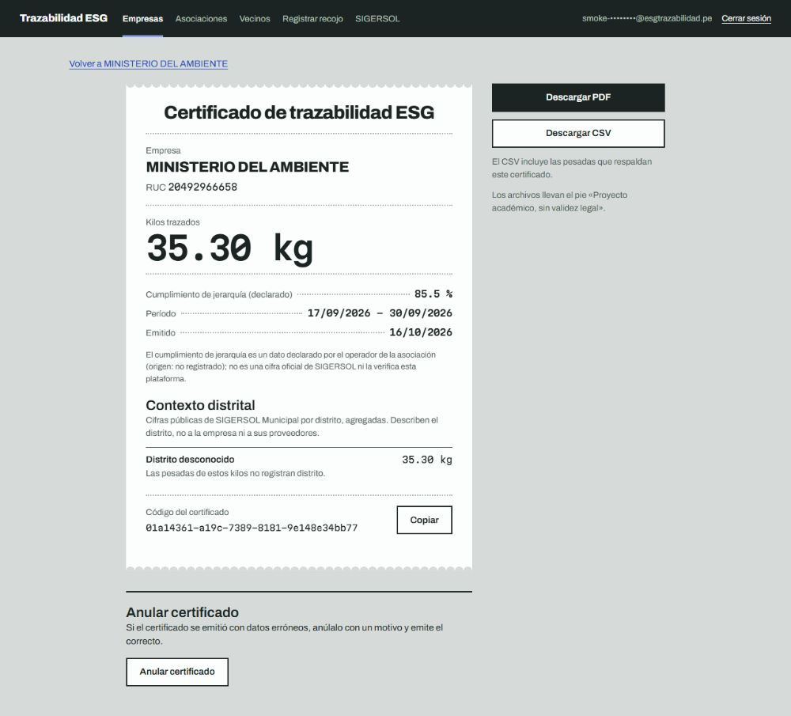
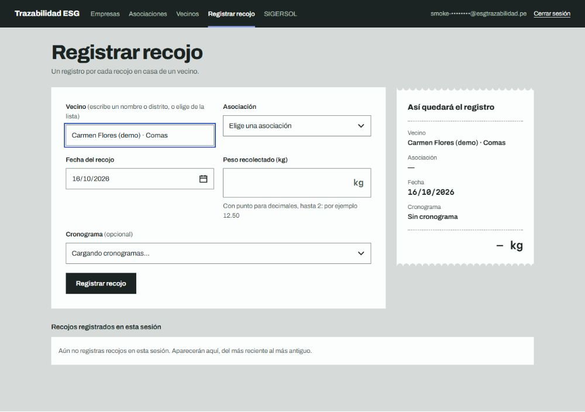
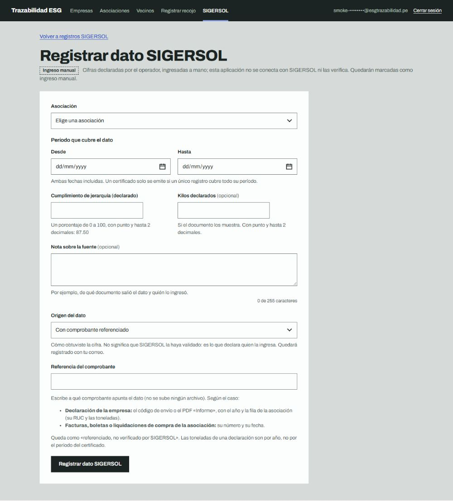
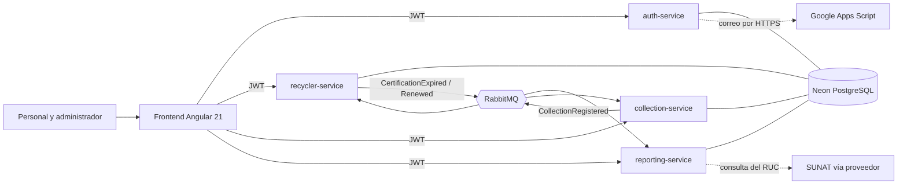

# Trazabilidad ESG para recicladores de Lima

Plataforma web que lleva la cuenta de cada kilo de residuo que recogen los recicladores formalizados de Lima Metropolitana y la convierte en un **certificado de trazabilidad ESG** que una empresa puede mostrar. Proyecto académico y de portafolio (CIBERTEC): los certificados llevan el pie «Proyecto académico, sin validez legal».

- **Sitio:** <https://esg-frontend-egcf.onrender.com> (los servicios están en el plan gratuito de Render: la primera visita puede tardar hasta 2 minutos mientras despiertan; la pantalla «Preparando el sistema» lo explica).
- **Portal de documentación:** <https://reedsy2407.github.io/esg-trazabilidad/> (cada endpoint en lenguaje de negocio, glosario de estados, catálogo de errores, decisiones de diseño y diagramas).

## Probar el sistema

Se puede probar el sistema real en menos de un minuto, sin registrarse:

1. Abre <https://esg-frontend-egcf.onrender.com>.
2. En la pantalla de inicio de sesión pulsa **«Entrar con la cuenta de demostración»** (entra en un clic).
3. Recorre una empresa, registra un recojo y abre un certificado: los pasos están en el capítulo [Recorrido de demostración](https://reedsy2407.github.io/esg-trazabilidad/recorrido-de-demostracion.html) del portal.

Si prefieres escribirla a mano:

- **Correo:** `demo@esg-trazabilidad.example`
- **Contraseña:** `bev2Yp2RyZuDqwJnuB7N`

> Es una cuenta de **demostración con datos ficticios** (o entidades públicas usadas como ejemplo): tiene el rol de personal, sin administración de cuentas, y todo lo que se registre lo verá quien use la cuenta. La contraseña es pública a propósito y no protege nada más que esos datos.
>
> La primera carga puede tardar hasta **un minuto** (a veces dos): los servicios están en el plan gratuito de Render y se duermen; la pantalla «Preparando el sistema» lo explica.

## El problema y para quién es

Una empresa que quiere decir «reciclamos» necesita poder probarlo con datos: cuántos kilos, de qué asociación de recicladores y en qué período. Los recicladores trabajan casa por casa y casi nunca dejan un rastro que se pueda auditar.

Esta plataforma es la consola del **personal de una operadora** (rol STAFF) y de su **administrador** (rol ADMIN):

1. Registra a los **vecinos** que entregan residuos y su **cronograma** de recojo.
2. Registra cada **recojo** (kilos, fecha, asociación). Los recojos no se editan ni se borran: son un libro de solo agregar.
3. Registra las **empresas** (verificadas contra SUNAT por su RUC), cada una vinculada a una asociación, y el **cumplimiento de jerarquía** que declara el operador de la asociación (SIGERSOL).
4. **Emite el certificado** de una empresa para un período: kilos trazados (los recojos de su asociación en ese período), cumplimiento declarado y contexto del distrito, en pantalla, PDF y CSV. Un certificado nunca se borra: si hay un error se **anula** con motivo y se emite el correcto.

> El cumplimiento de jerarquía es una cifra **declarada** por el operador; esta aplicación no se conecta con SIGERSOL ni la verifica (una integración real exigiría un convenio con el MINAM), y no es una cifra oficial. Los límites completos están en [limitaciones conocidas](portal/Writerside/topics/vision/limitaciones-conocidas.md).

## Capturas

| | |
|---|---|
|  |  |
| Empresas, con su estado | Una empresa: resumen del período y kilos por período |
|  |  |
| Certificado con PDF y CSV | Registrar un recojo |
|  | |
| Registrar el dato declarado de SIGERSOL | |

Datos de demostración: las empresas y vecinos de las capturas son ficticios o entidades públicas usadas como ejemplo, y la cuenta de personal aparece enmascarada.

## Arquitectura



| Servicio | Qué guarda y qué hace |
|---|---|
| `auth-service` | Cuentas del personal, roles, inicio de sesión, emisión del JWT y recuperación de contraseña por correo. |
| `recycler-service` | Asociaciones de recicladores, recicladores y sus certificaciones (con vencimiento). |
| `collection-service` | Vecinos, cronogramas y recojos (libro append-only). |
| `reporting-service` | Empresas, certificados ESG (PDF y CSV), registros SIGERSOL declarados y contexto distrital. |
| `shared-kernel` | Errores tipados, identificadores UUID v7, outbox/inbox, seguridad JWT común. |
| `frontend` | Consola Angular (componentes standalone, señales, rutas perezosas, CSS propio). |

**Decisiones de diseño que importan**

- **Hexagonal por servicio:** cada servicio separa `adapter/in/web` (controladores), `port/in` y `port/out` (puertos), `service` (casos de uso) y `adapter/out` (persistencia, correo, SUNAT). El dominio no conoce Spring ni la base de datos, por eso un proveedor (SUNAT, correo) se cambia sin tocar las reglas.
- **JWT sin estado:** `auth-service` firma (HS256) y los otros tres servicios validan **sin llamar** a auth, porque en el plan gratuito los servicios se duermen. Costo aceptado: un token ya emitido vale hasta que vence (1 hora).
- **Eventos con outbox:** el recojo y las certificaciones se comunican por RabbitMQ con patrón outbox/inbox, para no perder ni duplicar mensajes.
- **Gasto cero:** Render (gratis), Neon (gratis), CloudAMQP (gratis), GitHub Pages para el portal y Google Apps Script para el correo.

## Stack

Java 21 · Spring Boot 3.3 · Spring Security (JWT propio) · PostgreSQL 16 (Neon) · Liquibase · RabbitMQ · Angular 21 · Docker Compose (local) · Testcontainers · Playwright · GitHub Actions · Render · Writerside (portal).

## Cómo correrlo en local

Requisitos: JDK 21, Maven, Node 22, y un runtime de contenedores (Docker o Rancher Desktop en modo `dockerd`).

```bash
# 1. Variables locales (el archivo .env.local nunca se sube al repositorio)
cp .env.local.example .env.local      # llena POSTGRES_PASSWORD, DB_PASSWORD, RABBITMQ_PASSWORD,
                                      # JWT_SECRET (>= 32 bytes) y PASSWORD_RESET_PEPPER (>= 32 bytes)

# 2. PostgreSQL y RabbitMQ
docker compose --env-file .env.local up -d

# 3. Instala el módulo compartido una vez y arranca los cuatro servicios, cada uno en su terminal
mvn -DskipTests install
mvn -pl auth-service       spring-boot:run        # puerto 8084
mvn -pl recycler-service   spring-boot:run        # puerto 8081
mvn -pl collection-service spring-boot:run        # puerto 8082
mvn -pl reporting-service  spring-boot:run        # puerto 8083

# 4. El frontend (por defecto apunta a los servicios públicos; ver frontend/README.md)
cd frontend && npm ci && npm start           # http://localhost:5200
```

Ningún secreto tiene valor por defecto: sin las variables, el servicio **no arranca**. En el primer arranque con la tabla de cuentas vacía, `auth-service` crea la cuenta de `ADMIN_BOOTSTRAP_EMAIL` con una contraseña aleatoria que escribe una sola vez en el log.

## Cómo desplegarlo (Render, Neon y CloudAMQP, solo planes gratuitos)

Con este repositorio, `render.yaml` y el portal alcanza para ponerlo en una URL pública desde cero. Lo que es del repositorio está aquí; el detalle de cada proveedor y de cada variable está en el capítulo [Despliegue paso a paso](https://reedsy2407.github.io/esg-trazabilidad/despliegue-paso-a-paso.html) del portal (fuente: [portal/Writerside/topics/vision/despliegue-paso-a-paso.md](portal/Writerside/topics/vision/despliegue-paso-a-paso.md)).

1. **Copia el repositorio:** haz un fork o clónalo (`git clone https://github.com/Reedsy2407/esg-trazabilidad`) y súbelo a tu cuenta de GitHub. El CI vive en `.github/workflows/ci.yml` y Render solo despliega cuando ese CI queda en verde (`autoDeployTrigger: checksPass`), así que deja GitHub Actions habilitado.
2. **Crea la base y el broker** en la misma región de AWS que Render (el Blueprint usa `oregon`, es decir AWS `us-west-2`): un proyecto de **Neon** (usa el host de conexión *directa*, no el agrupado) y una instancia **Little Lemur** de **CloudAMQP**.
3. **Crea a mano el grupo de variables `esg-shared`** en Render (no en el Blueprint) con `JWT_SECRET` (≥ 32 bytes aleatorios), `DB_URL`, `DB_USERNAME`, `DB_PASSWORD`, `RABBITMQ_HOST`, `RABBITMQ_PORT` (`5671`), `RABBITMQ_USER`, `RABBITMQ_PASSWORD`, `RABBITMQ_VHOST` y `RABBITMQ_SSL_ENABLED` (`true`). Ningún secreto tiene valor por defecto: sin ellos el servicio no arranca.
4. **Variables propias de dos servicios** (se fijan en cada servicio, no en el grupo): `reporting-service` necesita `RUC_LOOKUP_PROVIDER` y `RUC_LOOKUP_TOKEN` (token de Decolecta); `auth-service` necesita `EMAIL_WEBHOOK_URL`, `EMAIL_WEBHOOK_SECRET` y `PASSWORD_RESET_PEPPER` (el correo sale por un Google Apps Script). Los valores y cómo obtenerlos están en el capítulo del portal.
5. **Aplica el Blueprint:** en Render, **New → Blueprint**, elige tu repositorio y la rama `main`. Render lee `render.yaml` y muestra cuatro servicios web (`esg-recycler-service`, `esg-collection-service`, `esg-reporting-service`, `esg-auth-service`) y el sitio estático `esg-frontend`. Cuando pida `ADMIN_BOOTSTRAP_EMAIL`, escribe el correo de la primera cuenta del personal.
6. **Lee la contraseña inicial** en **esg-auth-service → Logs** justo tras el primer despliegue (se escribe una sola vez, en una línea `email=… password=…`) y guárdala de inmediato. Si un servicio falla en su paso de Liquibase en el primer arranque, un *Manual Deploy* de ese servicio lo resuelve.
7. **Permite el origen del sitio:** en el grupo `esg-shared`, agrega `CORS_ALLOWED_ORIGINS` con la URL del sitio (`https://<tu-sitio>.onrender.com`, sin barra final y nunca `*`) y, si tus servicios tienen otros nombres, cambia las cuatro URL de `services` en `frontend/src/environments/environment.ts` y los hosts de `connect-src` en los encabezados del sitio de `render.yaml`.
8. **Comprueba:** cada servicio responde su commit en `GET /actuator/info` (el sitio, en `GET /version.json`), y la sonda `GET /actuator/health/liveness` da 200. La primera petición a un servicio dormido puede tardar hasta 2 minutos. Las pruebas manuales de extremo a extremo (token compartido entre servicios, evento por el broker, límite de intentos) están en el capítulo del portal.

Datos de demostración (opcional): `frontend/demo-seed/` carga, por las APIs públicas, una empresa, una asociación y recojos de ejemplo; su [README](frontend/demo-seed/README.md) explica cómo.

## Cómo se prueba

- **Unitarias** en cada módulo (JUnit 5, Mockito) y en el frontend (Vitest).
- **Pruebas de integración con PostgreSQL real** (Testcontainers) para cada servicio: la API completa, migraciones, restricciones de la base, concurrencia (dos peticiones a la vez) y la caída de la base de datos.
- **`e2e-tests`:** levanta los servicios como procesos reales y comprueba que un token de `auth-service` sirve en los demás.
- **Playwright** con un backend simulado en el frontend: flujos completos, teclado, accesibilidad con AXE y 360/768/1280 px.
- **CI** (GitHub Actions): compilación y pruebas de todos los módulos, lint, pruebas y build del frontend, Playwright, `npm audit` y búsqueda de secretos con gitleaks.

```bash
mvn verify                                  # todos los módulos (unitarias + integración)
cd frontend && npx ng lint && npm test -- --watch=false && npx ng build
cd frontend && npx playwright test     # flujos del navegador
```

## Seguridad en 5 líneas

1. Ningún secreto en el repositorio ni con valor por defecto; gitleaks revisa todo el historial en cada push.
2. Contraseñas de 15 a 64 caracteres (NIST 800-63B), con lista de contraseñas comunes bloqueadas; guardadas con BCrypt.
3. Dos roles (ADMIN y STAFF); la autoridad de ADMIN se comprueba en la base de datos, no en el token.
4. «Olvidé mi contraseña» en dos pasos: código de 8 dígitos (10 minutos, 5 intentos) y luego un token de un solo uso; ambos guardados como HMAC, con respuesta que no revela si la cuenta existe.
5. Errores tipados sin trazas ni datos internos; CORS con lista explícita; el frontend guarda el token solo en `sessionStorage`, con CSP.

Detalle de los 20 puntos y limitaciones aceptadas (por ejemplo, un JWT no se puede revocar antes de vencer) en el portal: [lista de seguridad](portal/Writerside/topics/vision/lista-de-seguridad.md) y [limitaciones conocidas](portal/Writerside/topics/vision/limitaciones-conocidas.md).

## Documentación

Toda la documentación está en el [portal](https://reedsy2407.github.io/esg-trazabilidad/), en español. Sus fuentes están en `portal/` (cómo se construye: [portal/README.md](portal/README.md)):

- [Despliegue paso a paso](portal/Writerside/topics/vision/despliegue-paso-a-paso.md): Neon, CloudAMQP, Render, variables y comprobación.
- [Lista de seguridad](portal/Writerside/topics/vision/lista-de-seguridad.md): los 20 puntos y las decisiones tomadas a propósito.
- [La consola del personal](portal/Writerside/topics/vision/consola-del-personal.md): qué pantalla usa cada endpoint y las reglas que viven solo en el frontend.
- [Rendimiento](portal/Writerside/topics/vision/rendimiento.md): qué se midió y qué cambió.
- [Limitaciones conocidas](portal/Writerside/topics/vision/limitaciones-conocidas.md): SIGERSOL, sesiones, correo, CSV y servicios que se duermen.
