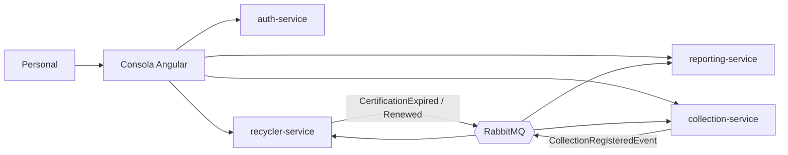

# Visión, servicios y flujo de punta a punta

## Para qué existe

Una empresa que dice «reciclamos» necesita poder probarlo: cuántos kilos, con qué asociación de recicladores y en qué período. Los recicladores trabajan casa por casa y casi nunca dejan un rastro auditable. %product% es la consola del personal de una operadora que **registra cada recojo** y, con esos registros, **emite certificados de trazabilidad ESG** para las empresas.

Es un proyecto académico y de portafolio: los certificados llevan el pie «Proyecto académico, sin validez legal».

## Los cuatro servicios

| Servicio | Qué guarda |
|---|---|
| [auth-service](referencia-auth.md) | Cuentas del personal, roles, inicio de sesión, token y recuperación de contraseña. |
| [recycler-service](referencia-recycler.md) | Asociaciones de recicladores, recicladores y certificaciones de cada asociación. |
| [collection-service](referencia-collection.md) | Vecinos, cronogramas y recojos (libro de solo agregar). |
| [reporting-service](referencia-reporting.md) | Empresas, certificados ESG (PDF y CSV), registros SIGERSOL declarados y contexto distrital. |

Los servicios no se llaman entre sí para validar datos: auth-service firma un token y los otros tres lo validan sin consultarlo; collection-service, recycler-service y reporting-service se comunican por **eventos** (RabbitMQ, con patrón outbox/inbox para no perder ni duplicar mensajes).

## Del kilo al certificado

<code-block lang="plantuml" src="../../puml/flujo-punta-a-punta.puml"/>

1. **Vecino.** El personal registra al vecino con su dirección y su distrito (uno de los 50 de Lima Metropolitana y Callao) y, si quiere, su [cronograma](cronogramas-del-vecino.md).
2. **Recojo.** Cada recojo anota kilos, fecha y asociación. No se edita ni se borra ([libro inmutable](recojos-inmutables.md)). Si la asociación tiene una certificación vencida y sin renovar, se rechaza (`COL-009`).
3. **Evento.** El recojo se publica y reporting-service lo guarda en su propio libro, con el distrito del vecino.
4. **Empresa.** La empresa se registra por su RUC (SUNAT trae el nombre legal) y se vincula a **una asociación**. Los kilos de sus certificados son los recojos de esa asociación en el período. Ver [estados de empresa](empresas-estados-independientes.md).
5. **Cumplimiento de jerarquía.** El operador de la asociación **declara** su cumplimiento de jerarquía de residuos para un período; el personal lo ingresa a mano ([SIGERSOL declarado](sigersol-declarado.md)). Sin un dato que cubra todo el período no se puede emitir (`RPT-005`).
6. **Certificado.** Se emite para un período: kilos trazados, cumplimiento declarado y contexto del distrito, todo **congelado**. Se descarga en [PDF y CSV](certificados-pdf-csv.md). Si tiene un error, se anula con motivo y se emite el correcto.

## Dos tipos de empresa

reporting-service tiene la **empresa rastreada** (`/tracked-companies`), a la que se emiten los certificados y la única que usa la consola. collection-service tiene además `/companies` (nombre, RUC, contacto), sin relación con la anterior: ningún evento las une. Hasta decidir cuál es «la empresa», `/companies` queda sin uso.

## Qué no es

- No está conectado con SIGERSOL ni valida sus cifras; una integración real exigiría un convenio con el MINAM. Ver [Limitaciones conocidas](limitaciones-conocidas.md).
- No es una plataforma oficial de ninguna entidad: es un proyecto académico.
